## 요약 (10줄 이내)
**지난 미팅** - 4-camera OTF 탑뷰 한계, AVM 대체 방향 재정리
- 260831의 Offline GS는 원본 탑뷰와 맞았지만 영상을 다 모은 뒤에만 가능함. 같은 일을 온라인(OTF[^otf])으로 하면 바닥이 뭉개지고 Gaussian[^gs]이 허공에 떠서, AVM(IPM)[^avm]을 바탕으로 바닥은 지도로 쌓고 물체에만 Gaussian을 올리는 쪽으로 바꿈

**합의 사항 -> 상태**
- [완료] 영상으로 차 위치를 추적하면서 바닥 지도와 물체 Gaussian을 함께 만드는 흐름을 끝까지 이어 돌림
- [부분] 물체 늘어짐·차 밑 빈칸: 차고 4개 장면[^scenes]은 늘어짐[^smear]이 AVM보다 0.07–0.10 줄었으나, 큰 차·야외 장면(04·06)은 오히려 AVM보다 큼
- [미착수] 경사·턱이 있는 바닥: 시험할 장면부터 만들어야 함

**이번 결과 / 막힌 것 / 다음**
- 결과: 바닥까지 Gaussian으로 만든 방식[^allg]과 비교하면 차 밑 PSNR[^psnr]은 6개 장면 모두 1.5–3.6 dB 높고 다듬기 시간은 0.57–0.66배임. 늘어짐은 차고 4개 중 2개에서만 이 방식보다 0.01 넘게 낮음
- 막힌 것: 어느 카메라도 본 적 없는 차 뒤 바닥 칸이 차·벽 색으로 굳음(장면 04)
- 다음: 못 본 바닥 칸을 비워 두기(C3), 그다음 바닥 모양 추정(D)

---

## 1. Insight를 얻은 논문

**AVM은 바닥 평면만 알면 바로 그릴 수 있음. 여기에 차 위치를 이어서 추적해 바닥을 시간으로 쌓고, 바닥 평면으로 설명이 안 되는 곳에만 Gaussian을 올림. 이 Gaussian이 가린 칸은 바닥 지도에서 빼고, 카메라가 한 번도 못 본 바닥은 비워 둠.**

| # | 논문 | 발표 | 입력 | 한 일 | 본 연구와 다른 점 |
| :-: | :-- | :-- | :-- | :-- | :-- |
| 1 | [OTF](https://arxiv.org/abs/2506.05558) (Meuleman et al.) | SIGGRAPH 2025 | 단일 카메라 | 영상이 들어오는 대로 자세와 Gaussian을 함께 만드는 온라인 재구성 | 지면 개념 없음, 학습된 단안 깊이 사용 |
| 2 | [Knorr](https://publikationen.bibliothek.kit.edu/1000081239) | KIT 박사논문 2017 | 차량 어안 다중 | 바닥 평면, 차 움직임, 카메라 외부 파라미터를 함께 추정 | 특징점 기반, 차 밑 채우기·물체 제거 없음 |
| 3 | [Fuchs & Paulus](https://library.imaging.org/ei/articles/30/17/art00013) | IS&T EI 2018 | 스테레오 | 세계 고정 격자에 영상을 시간으로 쌓고 높이 지도로 탑뷰 생성 | 물체 칸은 표시만 함, 정량 평가 없음 |
| 4 | [HGS-Mapping](https://arxiv.org/abs/2403.20159) (Wu et al.) | arXiv 2024 | RGB + LiDAR | 도로는 평면 위 2D Gaussian, 나머지는 3D Gaussian으로 온라인 재구성 | LiDAR 필요, 바닥도 Gaussian, 탑뷰·차 밑 미포함 |
| 5 | [ParkGaussian](https://arxiv.org/abs/2601.01386) (Wei et al.) | CVPR 2026 | 어안 4대 | 주차 장면을 바닥까지 전부 Gaussian으로 재구성 | 오프라인, 바닥 높이 z = 0 고정 |
| 6 | [Hybrid Mesh-Gaussian](https://www.ijcai.org/proceedings/2025/128) (Huang et al.) | IJCAI 2025 | RGB | 평평한 곳은 텍스처 메시 배경, 나머지는 Gaussian | 실내 오프라인, 메시를 미리 만듦 |
| 7 | [3D Gaussian Flats](https://arxiv.org/abs/2509.16423) (Taktasheva et al.) | arXiv 2025 | RGB | 평평한 면은 평면에 묶인 2D Gaussian, 나머지는 자유 3D Gaussian | 실내 오프라인, 의미 분할로 평면을 찾음 |

표의 용어 : 온라인[^online] · 외부 파라미터[^extr] · 세계 고정 격자[^grid] · 높이 지도[^hmap] · LiDAR[^lidar] · 2D·3D Gaussian[^2d3d] · 텍스처 메시[^mesh]

**논문별 insight**

1. **OTF** : 키프레임[^kf]마다 Gaussian을 바로 만들고 최근 몇 장으로만 다듬어 온라인으로 돌림. 그런데 지면 개념이 없어서, 바닥이 대부분인 주차 장면에서는 바닥이 지저분해짐.
2. **Knorr** : 바닥 평면을 기준으로 보면 바닥 점은 시차[^parallax]가 없고 물체 점에만 시차가 생겨 둘을 가를 수 있음. 자세가 조금만 밀려도 쌓아 둔 바닥 지도가 어긋남.
3. **Fuchs & Paulus** : 차를 따라 움직이는 세계 고정 격자에 영상을 쌓으면 차 밑과 물체 뒤 바닥이 채워짐. 칸마다 높이를 두면 울퉁불퉁한 바닥도 다룰 수 있음.
4. **HGS-Mapping** : 바닥과 물체를 다른 표현으로 나누면 Gaussian 수와 재구성 시간이 줄어듦(논문 보고: Gaussian 수 66 %, 재구성 20 % 빠름).
5. **ParkGaussian** : 어안 4대 주차 장면 재구성은 이미 CVPR에서 다룬 과제이고, 바닥까지 Gaussian으로 만드는 이 방식이 본 연구의 비교 대상임.
6. **Hybrid Mesh-Gaussian** : 앞 Gaussian을 통과한 빛(투과율[^trans])이 충분할 때만 배경을 갱신해서, 앞 물체 색이 배경에 찍히는 것을 막음.
7. **3D Gaussian Flats** : 무늬 없는 평평한 면은 밝기 비교(사진 손실[^photo])만으로는 깊이가 안 잡혀서, 평면에 묶어 줘야 함.

물체가 가린 곳의 배경을 갱신에서 빼는 생각은 Hybrid Mesh-Gaussian과 Fuchs & Paulus에 이미 있으나, 각각 실내 오프라인 방식과 스테레오 입력임. **본 연구는 이걸 카메라 4대만으로 온라인 탑뷰[^topview]에 적용하고, 정답 탑뷰로 효과를 잼.**

| 논문 | 대표 그림 (원 논문 발췌) | 볼 곳 |
| :-- | :-: | :-- |
| OTF | 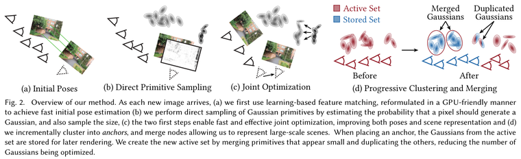 | 자세 추정 → Gaussian 직접 생성 → 짧은 창 최적화 |
| Knorr | 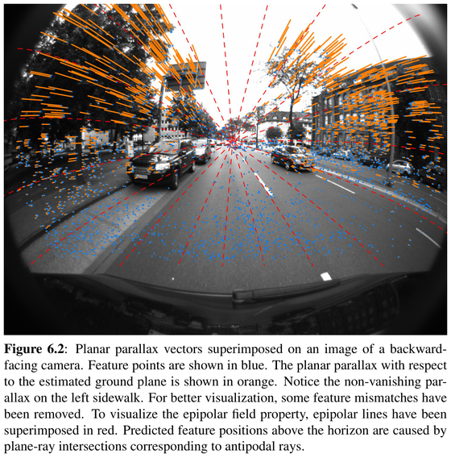 | 바닥 점은 시차가 없고 물체 점에만 주황 시차가 생김 |
| Fuchs & Paulus | 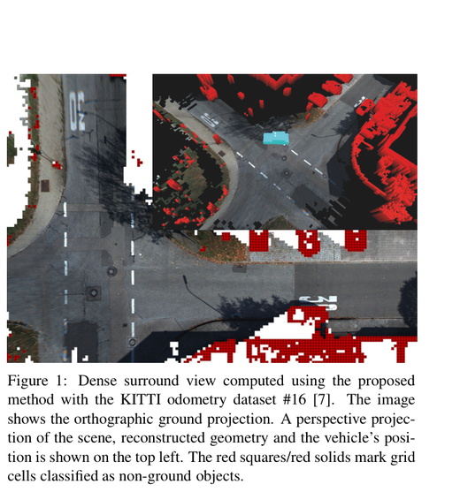 | 시간으로 쌓은 탑뷰, 빨간 칸은 물체로 분류된 칸 |
| HGS-Mapping | 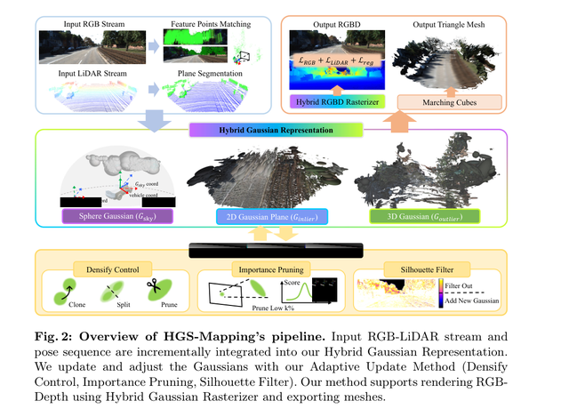 | LiDAR 평면으로 도로와 나머지를 나눠 다른 Gaussian으로 둠 |
| ParkGaussian | 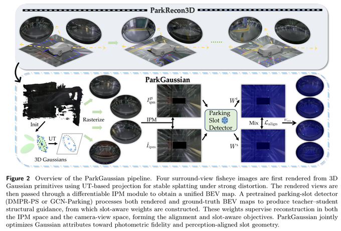 | 어안 4대 렌더를 탑뷰로 바꿔 주차 칸 검출과 맞춤 |
| Hybrid Mesh-Gaussian | 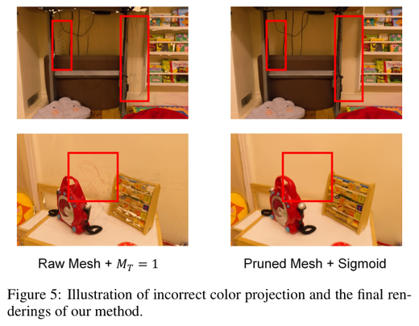 | 앞 물체 색이 배경에 찍힌 경우(왼쪽)와 투과율 규칙 적용 후(오른쪽) |
| 3D Gaussian Flats | 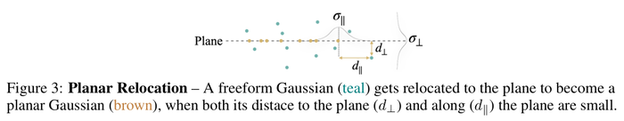 | 평면 가까운 자유 Gaussian을 평면 위로 옮김 |

## 2. 단계 구성 (A → D)

| 단계 | 얹는 것 | 풀리는 한계 | 가져온 insight | 다음 단계로 넘어가는 조건 |
| :-: | :-- | :-- | :-- | :-- |
| **A** | 보정 평면 하나에 4대 영상 투영 (현재 AVM) | 없음. 세 한계가 그대로 보이는 기준선 | — | 데이터셋 AVM과 같은 그림이 나옴 |
| **B** | 영상으로 차 이동량 추정 + 바닥으로 설명 안 되는 곳에만 여러 시점에서 확인된 Gaussian | 물체 윤곽이 생김. 늘어짐은 남음 | Knorr: 바닥 기준 자세, 평면 시차 · OTF: 키프레임마다 바로 생성 | 차고 장면(01·02·03·05) 이동량 오차 0.1 cm 이내, Gaussian 대부분이 물체 표면에 놓임 |
| **C** | 시간으로 쌓는 바닥 지도 + 확인된 Gaussian이 지도 칸을 가림 | ① 물체 늘어짐 · ② 차 밑 빈칸 | Fuchs: 시간 누적 지도 · HGS: 바닥과 물체 분리 · Huang: 투과율로 배경 갱신 차단 | 탑뷰에서 AVM보다 늘어짐이 줄고 차 밑이 채워짐 |
| **D** | 매 순간 바닥 평면 추정 → 칸마다 높이를 둔 높이 지도 | ③ 비평면 바닥 (경사·턱) | Knorr: 순간 평면 · Fuchs: 높이 지도 | 경사 전환·연석 장면에서 AVM보다 나음 |

**Gaussian을 얹기만 하면(B) 물체 자리에만 그려질 뿐, AVM이 바닥에 칠해 둔 자국은 그대로 남음. 그래서 C에서 그 칸을 바닥 지도에서 뺌.**

**단계 안의 세부 순서**
- C1 · C2 : 바닥 지도에서 물체 칸 빼기, 다른 방식과 비교.
- C3 : 못 본 바닥 칸은 비워 두기. 무늬 없는 차체는 3D Gaussian Flats처럼 평면에 묶어 덮는 방법을 검토.
- D1 : 차선 페인트처럼 노면보다 살짝 높은 무늬 때문에 이동 거리가 약 1 % 길게 잡히는 문제(장면 06) 확인.
- D2 : 경사·연석이 있는 합성 장면 만들기. 장면 06은 일정한 경사 위를 그대로 달려서 차에서 보면 바닥이 평면임.
- D3 · D4 : 매 순간 바닥 평면 추정, 그다음 칸마다 높이.

## 3. 논문 insight를 적용한 결과

비교군 : 지도만[^maponly] · 바닥까지 Gaussian[^allg]

**① 앞 물체가 가린 배경은 갱신에서 뺌 (Hybrid Mesh-Gaussian, Fuchs & Paulus) → 늘어진 자국이 짧아짐**

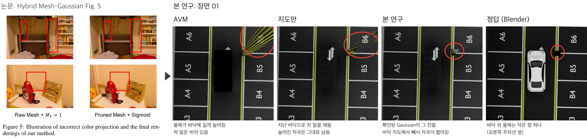

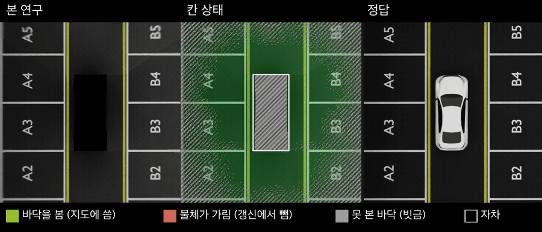

**② 바닥과 물체를 다른 표현으로 나눔 (HGS-Mapping) → 바닥까지 Gaussian으로 만든 것보다 바닥이 깨끗함**

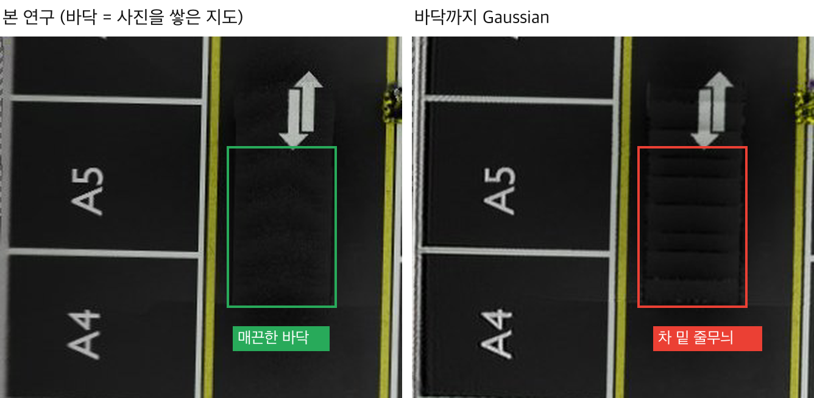

**③ 시간으로 쌓으면 차 밑과 물체 뒤가 채워짐 (Fuchs & Paulus) → 한 번도 못 본 바닥은 채울 수 없음** (회색은 정답 깊이로 표시한 평가용)

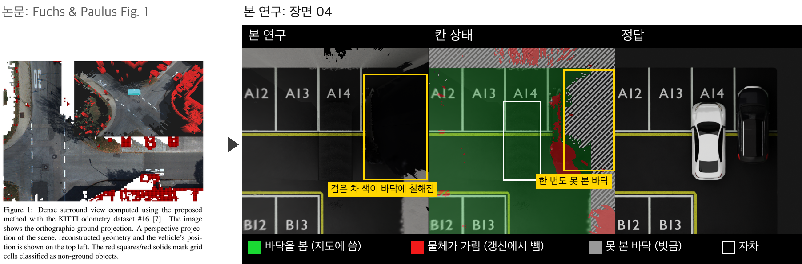

장면별 전체 영상(AVM / 지도만 / 본 연구 / 바닥까지 Gaussian / 정답): [01](../video_picture/261028/compare_scene01.mp4) · [02](../video_picture/261028/compare_scene02.mp4) · [03](../video_picture/261028/compare_scene03.mp4) · [04](../video_picture/261028/compare_scene04.mp4) · [05](../video_picture/261028/compare_scene05.mp4) · [06](../video_picture/261028/compare_scene06.mp4)

**판단 필요** : 경사·연석이 있는 합성 장면을 새로 만들지.

[^avm]: AVM(Around View Monitor) / IPM(Inverse Perspective Mapping): 차량 카메라 4대 영상을 바닥 평면 하나에 투영해 위에서 본 화면을 만드는 현재 양산 방식.
[^otf]: OTF(On-the-fly NVS): 촬영과 동시에 자세 추정과 3D 재구성을 함께 하는 방식. 본 연구의 이전 단계에서 출발점으로 쓴 방법임.
[^gs]: Gaussian(3D Gaussian Splatting): 장면을 위치·크기·색·투명도를 가진 작은 3D 타원체 수만–수십만 개로 표현하고, 이를 영상에 투영해 그리는 방식.
[^online]: 온라인: 전체 영상을 다 모은 뒤가 아니라 영상이 들어오는 순서대로 처리하는 것. 실시간과는 다름.
[^extr]: 외부 파라미터(extrinsic): 카메라가 차체 기준 어디에 어떤 각도로 달려 있는지를 나타내는 값.
[^grid]: 세계 고정 격자: 차가 움직여도 바닥에 고정된 칸 좌표. 같은 바닥 칸을 여러 시점에서 계속 갱신할 수 있음.
[^hmap]: 높이 지도(height map, 2.5D): 바닥 칸마다 높이 값 하나를 두는 표현. 평면 하나보다 경사·턱을 표현할 수 있음.
[^topview]: 탑뷰(top view): 차 위에서 내려다본 화면. AVM이 운전자에게 보여 주는 화면임.
[^lidar]: LiDAR: 레이저로 거리를 직접 재는 센서. 본 연구는 쓰지 않고 카메라만 씀.
[^2d3d]: 2D Gaussian / 3D Gaussian: 2D는 두께가 없는 납작한 원판, 3D는 부피가 있는 타원체.
[^mesh]: 텍스처 메시(textured mesh): 삼각형 면에 사진을 입힌 3D 표면.
[^kf]: 키프레임(keyframe): 모든 프레임이 아니라 일정 조건에서 골라 재구성에 쓰는 프레임.
[^parallax]: 평면 시차(planar parallax): 바닥 평면 위의 점이라고 가정했을 때 예측한 위치와 실제 위치의 차이. 바닥 점은 0에 가깝고, 바닥 위로 솟은 물체 점에서만 커짐.
[^trans]: 투과율(transmittance): 앞의 Gaussian들을 지나 뒤까지 남는 빛의 비율. 1이면 앞에 아무것도 없고, 0이면 앞이 완전히 가려짐.
[^photo]: 사진 손실(photometric loss): 다시 그린 영상과 실제 영상의 밝기 차이. 무늬가 없으면 위치를 바꿔도 차이가 거의 변하지 않음.
[^psnr]: 차 밑 PSNR: 지금 자차가 덮고 있는 칸을 이전에 본 정답 바닥과 비교한 값(dB). 높을수록 정답에 가까움.
[^scenes]: 장면: Blender 합성 6개. 01·02·05 실내 차고, 03 기둥이 있는 차고, 04 큰 검은 차 옆 평행 주차, 06 야외 8 % 일정 경사.
[^smear]: 늘어짐 오차: 정답에서는 바닥인데 AVM이 물체를 칠하는 칸에서, 결과와 정답의 밝기 차이를 평균한 값. 낮을수록 좋음.
[^allg]: 바닥까지 Gaussian: 바닥 칸마다 납작한 Gaussian을 깔고 물체 Gaussian은 본 연구와 같은 규칙으로 만든 뒤, 가림 없이 다듬기로만 맞춘 비교군. 260831의 Offline GS와 달리 영상이 들어오는 순서대로 돌림.
[^maponly]: 지도만: 본 연구에서 물체 Gaussian과 가림을 뺀 것. 시간으로 쌓은 바닥 지도만 그림.
