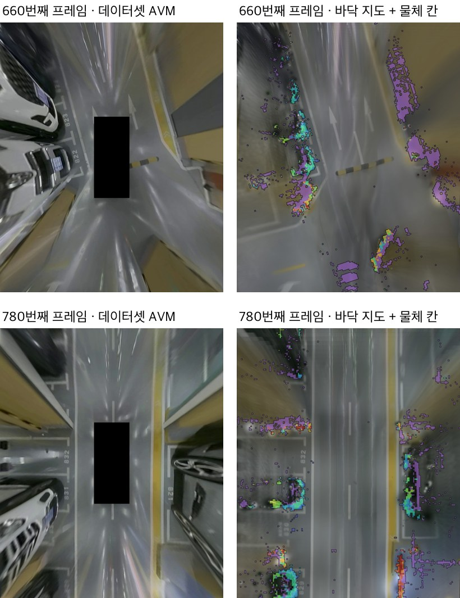
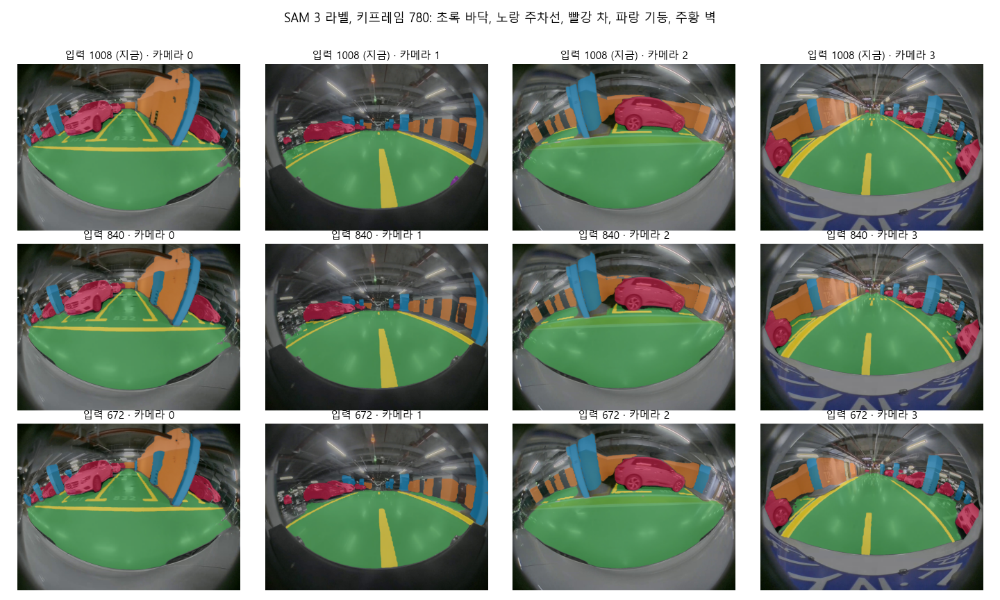
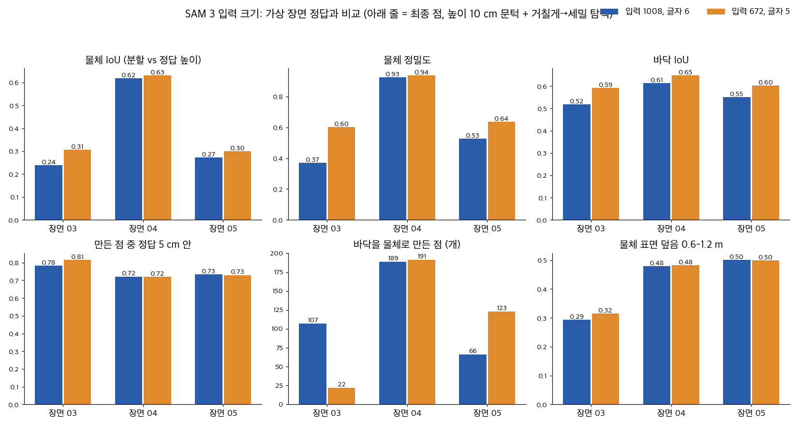

## 요약 (10줄 이내)
**지난 미팅 (2026-11-05)** - 바닥·물체 분리 순서, 시차 측정, 차 위치, 바닥 면
- 분할(segmentation)로 바닥과 물체를 먼저 가르고 차가 움직여 생기는 시차로 높이를 확인함. 시차는 서브픽셀로 재고, 차 위치는 바퀴·IMU로, 바닥은 이어진 면(mesh)으로 표현하기로 함

**합의 사항 -> 상태**
- [완료] SAM 3 분할 → 바닥 지도 누적 + 시차 높이 → 물체 칸 표시까지 실제 데이터(ParkRecon3D data3, 30초)에서 온라인으로 이어 돌림
- [부분] 시차는 위상 상관으로 서브픽셀까지 측정함. 주차칸 모서리를 기준점으로 쓰는 것은 아직 안 함
- [완료] 바퀴·IMU에 영상으로 차 위치를 다듬는 것을 더해 봤으나 지도 위치 오차가 줄지 않아 바퀴·IMU만 씀
- [부분] 바닥 면은 가상 경사로에서만 맞고 실제 데이터에서는 효과 없음

**이번 결과 / 확인하지 못한 것**
- 결과: 키프레임 처리 시간을 2,562 ms에서 1,993 ms로 줄였고, SAM 3 입력을 672로 줄이면 1,443 ms임(예산 500 ms). 672는 가상 장면 정답 비교에서 1008보다 낮지 않음
- 확인하지 못한 것: 실제 데이터에서 물체 칸의 정답 비교(손 라벨 20장 작성 전), 물체 칸의 71 %는 높이를 재지 못함

---

## 1. 처리 순서

어안 영상을 바닥 평면에 그대로 투영하는 AVM은 모든 화소가 바닥(z = 0)에 있다고 가정하므로, 높이가 있는 차·벽이 바닥에 길게 늘어짐. 이를 피하려고 화소를 먼저 바닥과 물체로 나누고 따로 처리함.

| 순서 | 하는 일 | 입력 | 주기 |
| :-: | :-- | :-- | :-- |
| ① 차 위치 | 뒤바퀴 속도 평균 × 보정값, IMU 회전 속도로 적분 | 바퀴 4개, IMU | 매 프레임 (10 fps) |
| ② 분할 | SAM 3(`facebook/sam3`, 미세조정 없음)에 글자 6개(floor, parking line, car, pillar, wall, person)를 주고 어안 영상을 펴지 않은 채 바닥 / 물체로 나눔 | 어안 4대 | 키프레임 (0.5초마다) |
| ③ 바닥 지도 | 바닥 화소의 광선과 z = 0 평면의 교점을 세계 좌표 1.05 cm 칸에 가중 평균으로 누적 | 어안 4대, ①, ② | 매 프레임 |
| ④ 시차 높이 | 앞 키프레임 2장과 비교해 거리를 찾고, 여러 장에서 같은 거리로 확인된 점만 높이를 계산 | 어안 4대, ① | 키프레임 |
| ⑤ 물체 칸 | 10 cm 칸마다 SAM 3의 바닥→물체 경계와 ④의 높이를 점수로 누적해 물체 칸을 표시하고, 가까운 물체에는 Gaussian을 생성·최적화 | ②, ④ | 키프레임 |

- 데이터셋의 AVM 탑뷰, 주차칸 라벨, 가상 장면 정답은 평가에만 쓰고 실행 입력이나 미리 정하는 값에는 넣지 않음.
- 평가 구간은 ParkRecon3D data3의 600–900 프레임(30초, 74 m, 키프레임 61개)임.

## 2. 결과: AVM 탑뷰와 비교

- AVM : 주차된 차와 벽이 바닥에 늘어져 주차칸을 덮음.
- 바닥 지도 + 물체 칸 : 물체는 선 위치에만 표시되고, 그 뒤 바닥은 카메라가 본 적이 있으면 바닥 지도로 채워짐. 회색은 아직 본 적 없는 바닥임.

차가 지나가며 통로 양쪽 주차칸 바닥이 채워지고, 주차된 차와 기둥 자리는 물체 칸으로 남음.

탑뷰에서는 높이가 보이지 않아, 같은 지도를 옆과 뒤쪽 위에서 그림. 물체 칸마다 잰 높이까지 기둥을 세움.

- 기둥은 실제 차·벽 자리에 서 있고, 차(약 1–1.3 m)와 벽(2 m 이상)의 높이 차이가 보임.
- 840번째 키프레임에서 물체 칸 12,142개 중 높이를 잰 칸은 3,510개(29 %)임. 높이를 못 잰 칸은 그림에서 이웃 칸 값으로 채우거나 0.3 m로 그렸고, 잰 차 높이도 지붕보다 낮은 곳이 많음.
- 어안에 겹친 그림은 렌더러의 위치·방향 확인용이며, 지도도 같은 카메라로 만들었으므로 지도의 독립 검증은 아님.

## 3. 정확도 측정

| 항목 | 방법 | 결과 |
| :-- | :-- | :-- |
| 지도 위치 | 데이터셋 주차칸 라벨 모서리를 프레임마다 지도에 찍어 흩어지는 정도를 잼 | 흩어짐 중앙값 7.6–12.5 cm (4개 구간). 차에서 1–2 m는 5–9 cm, 4–6 m는 15–19 cm |
| 차 위치 보정 | 키프레임마다 앞 키프레임과 바닥 무늬를 맞춰 차 위치를 다듬음 | 바닥 높이는 1 cm 안으로 맞으나, 모서리 흩어짐은 평가 구간에서 같거나 커짐. 미채택 |
| 바닥 면 | 진행 방향으로 몇 m마다 높이를 두고 시차 바닥 점에 맞춤 | 가상 15 % 경사로 높이 오차 9 cm(IMU 기울기 사용). 실제 데이터에서는 바퀴 보정값을 0.8 % 바꾸면 높이가 최대 1.9 m 달라져 효과 없음 |
| 물체 칸 | 가상 주차장 3곳의 정답 높이와 비교 | 바닥을 물체로 잘못 표시한 칸 12 % → 1.4 % |

- 카메라 외부 파라미터를 다시 맞춰도 모서리 흩어짐은 데이터셋 값과 거의 같아, 오차의 대부분은 프레임 사이 차 위치(바퀴 + IMU)에서 온다고 봄.
- 차 위치 보정량이 실제 차체 움직임보다 10배 넘게 커서, 외부 파라미터 오차와 평면이 아닌 바닥까지 차 자세로 떠안은 것으로 봄.

## 4. 처리 시간

영상은 10 fps이고 키프레임은 5프레임마다이므로, 실시간이 되려면 매 프레임 일은 100 ms, 키프레임 일은 500 ms 안에 끝나야 함. 매 프레임 바닥 지도 누적은 33 ms(p95 39 ms)로 예산 안임. 아래는 키프레임 하나의 단계별 중앙값(ms)이며 RTX 4070 Ti 1장, 평가 구간 키프레임 61개 기준임.

| 단계 | 처음 | 메모리 설정 + 생성 GPU | + SAM 3 입력 672, 글자 5 |
| :-- | --: | --: | --: |
| SAM 3 분할 | 1,415 | 1,098 | 561 |
| 거리 탐색 (시차) | 352 | 350 | 340 |
| 최적화 (Gaussian) | 231 | 216 | 216 |
| Gaussian 생성 | 363 | 153 | 152 |
| 나머지 (영상 읽기, 생성 확률, 렌더, 물체 칸, 그리기) | 약 200 | 174 | 167 |
| **합계 (p50 / p95)** | **2,562 / 2,659** | **1,993 / 2,085** | **1,443 / 1,507** |

- SAM 3 : GPU 메모리가 12 GB 중 11.9 GB까지 차면서 키프레임 680부터 1,120 ms에서 1,430 ms로 늘었음. 메모리 할당 방식(`expandable_segments`)만 바꿔 1,098 ms로 돌아옴. 남은 시간은 영상 인코더 543 ms + 디코더 463 ms임.
- Gaussian 생성 : CPU에서 하던 반사 판정(178 ms → 8 ms)과 거리 일치 확인·좌표 계산을 GPU로 옮김. 반사 판정은 실제 영상 244장에서 화소 단위로, 거리 확인·좌표는 임의 입력 40경우에서 비트 단위로 바꾸기 전과 같음을 확인함.
- 거리 탐색과 최적화는 아직 손대지 않음. 두 단계만으로 약 560 ms라 SAM 3을 빼도 예산을 넘음.

## 5. SAM 3 입력 크기

모델은 그대로 두고 입력 영상 크기(기본 1008 × 1008)와 글자 수만 바꿔 봄. 글자에서 "person"을 빼면 라벨이 99.98 % 같아, 아래 비교는 모두 글자 5개임.

차이는 물체 경계와 가는 주차선(카메라 2)에 몰림. 1008 결과와의 물체 IoU는 840에서 0.88, 672에서 0.82임.

1008 결과는 정답이 아니므로, 정답 높이가 있는 Blender 가상 주차장 3곳(키프레임 37 / 39 / 71개)에서 두 방식을 같은 코드로 돌려 정답과 비교함. 정답 높이 5 cm 이상인 화소를 물체로 봄.

- 분할 : 3곳 모두 672가 정답에 더 가까움. 물체 정밀도가 0.37 → 0.60, 0.93 → 0.94, 0.53 → 0.64로 오르고 재현율은 같은 수준임.
- 최종 점 : 장면 03은 672가 낫고(정답 5 cm 안 0.78 → 0.81) 04·05는 같음. 장면 05에서 바닥 위에 만든 물체 점만 66개 → 123개로 늘었으나 만든 점 30,222개의 0.4 %임.
- 두 방식 모두 가상 장면에서 물체 IoU가 0.24–0.63으로, SAM 3이 물체를 절반 정도만 잡음. 입력 크기와는 무관함.
- 실제 데이터 전체 빌드에서 672의 물체 칸은 1008의 물체 칸과 95 %가 10 cm 안, 98 %가 20 cm 안에 있음. 실제 데이터의 정답 비교는 손 라벨이 필요해 아직 못 함.

현재 기본값은 1008이며, 672로 바꾸지 않은 상태임.
