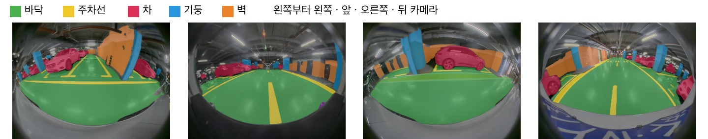
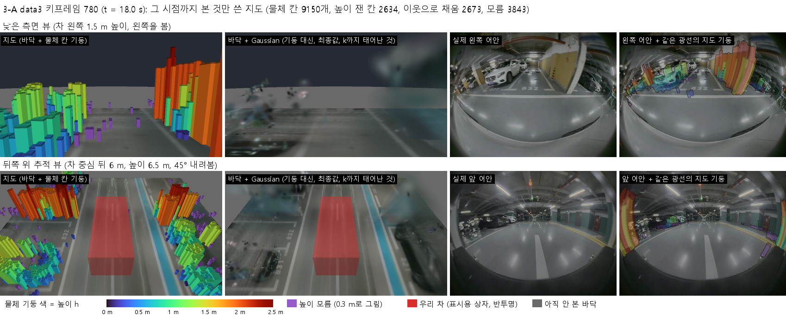

## 요약 (10줄 이내)
**지난 미팅 (2026-11-05)** - 바닥·물체 분리 순서, 시차, 차 위치, 바닥 면
- 분할로 바닥과 물체를 먼저 가르고, 차가 움직여 생기는 시차로 높이를 확인하기로 함. 차 위치는 바퀴·IMU로, 바닥은 이어진 면으로 표현하기로 함

**합의 사항 -> 상태**
- [완료] 실제 주차장 영상 30초에서 분할 → 바닥 지도 → 시차 높이 → 물체 위치 표시를 온라인으로 실행함
- [완료] 영상으로 차 위치를 다듬어 봤으나 지도 위치 오차가 줄지 않아 바퀴·IMU 값을 씀
- [부분] 바닥 면은 가상 경사로는 따라가고(높이 오차 9 cm), 실제 데이터에서는 평면과 차이 없음

**이번 결과**
- AVM에서 바닥에 늘어지던 주차된 차와 벽이 서 있는 자리에만 표시됨
- 키프레임 하나 처리 시간 2.6초 → 2.0초, SAM 3 입력을 줄이면 1.4초 (실시간 목표 0.5초)

---

## 1. 실행 환경

| 항목 | 내용 |
| :-- | :-- |
| 장비 | RTX 4070 Ti 12 GB 1장 |
| 데이터 | AVM-SLAM 지하 주차장 데이터 data3, 30초 주행 (74 m) |
| 입력 | 어안 카메라 4대 (10 fps), 바퀴 속도, IMU |
| 처리 단위 | 바닥은 매 프레임, 분할과 물체는 0.5초마다 (키프레임, 30초 동안 61개) |
| 평가에만 쓴 것 | 데이터셋 AVM 탑뷰, 주차칸 라벨, 가상 주차장 정답 |

## 2. 처리 흐름

AVM은 영상의 모든 화소가 바닥에 있다고 보고 바닥 평면에 투영함. 그래서 높이가 있는 차와 벽이 바닥에 길게 늘어짐. 이를 피하려고 화소를 먼저 바닥과 물체로 나눠 따로 처리함.

| 순서 | 하는 일 |
| :-: | :-- |
| ① 차 위치 | 바퀴 속도와 IMU 회전으로 차가 어디에 있는지 계산 |
| ② 분할 | SAM 3으로 어안 영상의 화소를 바닥 / 물체로 나눔 |
| ③ 바닥 지도 | 바닥 화소만 바닥 평면에 투영해 세계 지도에 계속 쌓음 |
| ④ 물체 위치 | 차가 움직이기 전후 영상의 시차로 물체 높이를 재고, 물체가 서 있는 자리를 지도에 표시 |

## 3. 분할: SAM 3

| 항목 | 내용 |
| :-- | :-- |
| 모델 | SAM 3 (Meta, `facebook/sam3`), 공개 가중치 그대로 사용 (추가 학습 없음) |
| 입력 | 어안 영상을 펴지 않고 그대로, 1008 × 1008 |
| 찾는 대상 (글자로 지정) | floor, parking line, car, pillar, wall, person |
| 판정 | 검출 점수 0.5 이상만 사용 |
| 바닥 / 물체 | 바닥 = floor, parking line, 물체 = car, pillar, wall |
| 시간 | 카메라 4장에 1.1초 |

어안 영상 가장자리의 휘어진 차·기둥·벽도 물체로 나뉘고, 바닥과 주차선은 바닥으로 나뉨.

## 4. 결과

- AVM : 주차된 차와 벽이 바닥에 늘어져 주차칸을 덮음.
- 바닥 지도 + 물체 위치 : 물체는 서 있는 자리에만 표시되고, 차 뒤 바닥은 앞서 본 영상으로 채워짐. 회색은 아직 카메라에 들어온 적 없는 바닥임.

차가 지나가며 통로 양쪽 주차칸 바닥이 채워지고, 주차된 차와 기둥 자리는 물체로 남음.

탑뷰에서는 높이가 안 보여서, 물체 자리마다 시차로 잰 높이만큼 기둥을 세워 옆에서 봄. 기둥이 실제 차·벽 자리에 서 있고, 차(약 1–1.3 m)와 벽(2 m 이상)의 높이 차이가 보임.

## 5. 지도 위치 정확도

데이터셋의 주차칸 라벨 모서리를 프레임마다 지도에 찍으면, 위치가 정확할수록 한 점에 모임. 흩어진 정도(중앙값)는 4개 구간에서 7.6–12.5 cm임.

- 오차는 주로 프레임 사이 차 위치(바퀴 + IMU)에서 옴. 영상으로 차 위치를 다듬어 봤으나 흩어짐이 줄지 않아 바퀴·IMU 값을 씀.
- 바닥 면 : 가상 15 % 경사로에서는 높이 오차 9 cm로 따라감. 실제 데이터에서는 바퀴 속도 배율이 0.8 %만 달라도 높이가 최대 1.9 m 달라져 평면과 차이가 없음.

## 6. 처리 시간

실시간이 되려면 키프레임 하나를 0.5초 안에 끝내야 함. 바닥 지도는 프레임당 33 ms로 이미 실시간임.

| 키프레임 하나 (ms) | 처음 | 지금 | SAM 3 입력 672 |
| :-- | --: | --: | --: |
| SAM 3 분할 | 1,415 | 1,098 | 561 |
| 시차 높이 | 352 | 350 | 340 |
| 물체 Gaussian 생성·다듬기 | 594 | 369 | 368 |
| 기타 (영상 읽기, 그리기 등) | 201 | 174 | 167 |
| **합계** | **2,562** | **1,993** | **1,443** |

- 처음 → 지금 : GPU 메모리가 거의 차면서 SAM 3이 느려지던 것을 메모리 할당 설정으로 고치고, CPU에서 하던 Gaussian 생성 계산을 GPU로 옮김. 결과는 바꾸기 전과 같음.
- SAM 3 입력 672 : 다음 절.

## 7. SAM 3 입력 크기 줄이기

SAM 3 입력을 1008에서 672로 줄이고 찾는 대상에서 person을 빼면, SAM 3 시간이 1,098 ms에서 561 ms로 절반이 됨. 정확도가 떨어지는지 정답 높이가 있는 Blender 가상 주차장 3곳에서 비교함.

| 가상 장면 | 물체로 나눈 화소 중 실제 물체 비율 (1008 → 672) | 만든 점 중 정답 5 cm 안 (1008 → 672) |
| :-- | :-: | :-: |
| 03 | 0.37 → 0.60 | 0.78 → 0.81 |
| 04 | 0.93 → 0.94 | 0.72 → 0.72 |
| 05 | 0.53 → 0.64 | 0.73 → 0.73 |

입력을 줄여도 정답과의 차이는 같거나 더 작음. 실제 데이터에서도 672로 찍은 물체 자리의 95 %가 1008 결과에서 10 cm 안에 있음.
