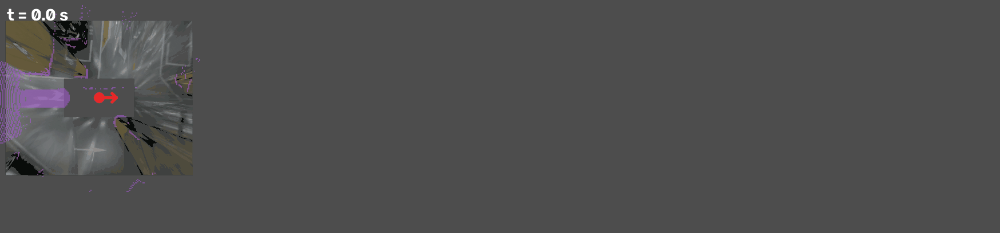

## 요약 (10줄 이내)
**지난 미팅 (2026-11-05)** - 바닥·물체 분리 순서, 시차 측정, 차 위치, 바닥 면
- 분할로 바닥과 물체를 먼저 가르고 차 이동으로 생기는 시차로 높이를 확인함. 시차는 서브픽셀로 재고, 차 위치는 바퀴·IMU로, 바닥은 이어진 면(mesh)으로 표현하기로 함

**합의 사항 -> 상태**
- [완료] SAM 3 분할 → 바닥 지도 누적 → 시차 높이 → 물체 칸 표시를 실제 주차장 영상 30초(키프레임 61개)에서 온라인으로 실행함
- [완료] 시차는 위상 상관으로 서브픽셀까지 잼. 평평한 바닥의 높이 흔들림은 1 m 이동 쌍 2.4 cm, 3 m 이동 쌍 1.2 cm
- [완료] 영상으로 차 위치를 다듬는 방식을 시험한 결과 주차칸 모서리 흩어짐이 줄지 않아, 차 위치는 바퀴·IMU 값을 씀
- [부분] 바닥 면은 가상 15 % 경사로에서 높이 오차 9 cm로 따라가고, 실제 데이터에서는 평면과 차이 없음

**이번 결과**
- 키프레임 처리 시간 2,562 ms → 1,993 ms. SAM 3 입력을 672로 줄이면 1,443 ms이고, 가상 장면 정답과 비교한 분할 물체 정밀도는 1008보다 0.01–0.23 높음

---

## 1. 실행 환경과 데이터

| 항목 | 값 |
| :-- | :-- |
| GPU | RTX 4070 Ti 12 GB 1장 (Windows WSL2 Ubuntu, RAM 15.6 GB) |
| 소프트웨어 | Python 3.10, PyTorch 2.7.1 + CUDA 12.8, gsplat 1.6.0, transformers 4.57.6 |
| 데이터 | AVM-SLAM 지하 주차장 데이터 (ParkRecon3D 사본) data3, 600–900 프레임 (30초, 74 m) |
| 입력 | 어안 카메라 4대 (1280 × 960, 10 fps), 바퀴 속도 4개, IMU |
| 카메라 값 | 내부 파라미터는 데이터셋 값 그대로, 외부 파라미터는 데이터셋 값을 영상으로 다시 맞춘 값 |
| 키프레임 | 5프레임(0.5초)마다, 61개 |
| 평가에만 쓴 것 | 데이터셋 AVM 탑뷰, 주차칸 라벨, Blender 가상 주차장 정답 높이 |

## 2. 단계별 구현

어안 영상을 바닥 평면에 그대로 투영하는 AVM은 모든 화소를 바닥(z = 0)으로 가정하므로, 높이가 있는 차·벽이 바닥에 길게 늘어짐. 그래서 화소를 먼저 바닥과 물체로 나눈 뒤, 바닥은 평면에 쌓고 물체는 시차로 높이를 재서 위치만 표시함.

| 순서 | 단계 | 주기 | 입력 → 출력 |
| :-: | :-- | :-- | :-- |
| ① | 차 위치 | 매 프레임 | 바퀴 속도, IMU → 차의 세계 좌표 위치·방향 |
| ② | 분할 (SAM 3) | 키프레임 | 어안 4장 → 화소별 바닥 / 물체 / 기타 |
| ③ | 바닥 지도 | 매 프레임 | 어안 4장, ①, ② → 1.05 cm 칸 색 지도 |
| ④ | 시차 높이 + Gaussian | 키프레임 | 어안 4장, ① → 물체 점의 거리·높이, 물체 Gaussian |
| ⑤ | 물체 칸 | 키프레임 | ②, ④ → 10 cm 칸 물체 표시 |

### ① 차 위치

| 항목 | 값 |
| :-- | :-- |
| 이동 속도 | 뒤바퀴 2개 속도 평균 × 바퀴 배율 1.017 |
| 회전 | IMU 회전 속도 적분 |
| 차체 기본 자세 | 녹화별 pitch·roll 고정값 |

### ② 분할: SAM 3

| 항목 | 값 |
| :-- | :-- |
| 모델 | SAM 3 (Meta), Hugging Face `facebook/sam3`, 체크포인트 3.44 GB, 미세조정 없음 |
| 구조 | ViT 영상 인코더 32층 (패치 14, 입력 1008 → 72 × 72 격자) + DETR식 인코더·디코더 각 6층, 질의 200개 |
| 입력 | 어안 영상을 펴지 않고 그대로, 1008 × 1008로 크기 변경 |
| 글자 질의 (6개) | floor, parking line, car, pillar, wall, person |
| 정밀도 | fp16 autocast (가중치는 fp32) |
| 문턱 | 검출 점수 0.5, 마스크 0.5 |
| 겹칠 때 | floor → parking line → wall → pillar → car → person 순으로 칠해 뒤가 이김 |
| 묶음 | 바닥 = floor, parking line / 물체 = car, pillar, wall |
| 실행 방식 | 영상 인코더는 영상마다 1번, 글자 특징은 시작할 때 1번 계산해 재사용, 글자 6개를 디코더 한 번에 처리 |
| 시간 | 키프레임(4장)당 1,098 ms = 영상 인코더 543 + 디코더 463 + 전후처리 92 |

공개 분할 모델 5개를 같은 어안 영상에 돌려 비교한 뒤 SAM 3을 골랐음.

차와 기둥·벽은 물체로, 바닥과 주차선은 바닥으로 나뉨. 입력 크기에 따른 차이는 물체 경계와 가는 주차선(카메라 2)에서 생김.

### ③ 바닥 지도

| 항목 | 값 |
| :-- | :-- |
| 투영 | 어안 렌즈 모델(Kannala-Brandt)로 화소 광선을 구해 z = 0 평면과의 교점을 세계 좌표로 옮김 |
| 칸 크기 | 1.05 cm |
| 누적 | 칸마다 가중 평균. 가중치 = 화소 하나가 바닥에서 차지하는 면적의 역수 × 영상 선명도 |
| 제외 | SAM 3이 물체로 본 화소, 자차 주변 0.8 m, 반사로 밝게 튄 화소 |
| 시간 | 프레임당 33 ms (p95 39 ms) |

### ④ 시차 높이와 물체 Gaussian

| 항목 | 값 |
| :-- | :-- |
| 비교 영상 | 앞 키프레임 2개 (0.5초, 1초 전) |
| 거리 탐색 | 화소 광선 위 거리 후보를 참조 영상에 투영해 무늬를 비교. 거칠게 4칸 간격으로 찾은 뒤 주변을 세밀하게 찾음 |
| 거리 확정 | 참조 영상 2개 이상의 거리가 max(5 cm, 거리의 2 %) 안에서 일치할 때만 |
| 높이 범위 | -2 cm 미만, 2.5 m 초과는 버림. 10 cm 미만은 바닥으로 봄 |
| Gaussian 생성 | 확정된 물체 점에서, 카메라·키프레임당 최대 5,000개 |
| Gaussian 최적화 | 최근 키프레임 8개, 30회, Adam. 손실 = L1 색 차이 + 0.5 × 물체 마스크 BCE, gsplat 어안 렌더 |

시차 원리 : 높이 z인 점은 바닥 평면에 투영했을 때 카메라 이동 b에 비례해 z / (H − z)만큼 밀림 (H = 카메라 높이). 바닥 점은 밀리지 않음.

### ⑤ 물체 칸

| 항목 | 값 |
| :-- | :-- |
| 칸 크기 | 10 cm |
| SAM 3 점수 | 바닥 → 물체로 바뀌는 경계 화소가 놓인 칸은 +, 그 앞 바닥 화소가 놓인 칸은 − |
| 시차 점수 | ④에서 잰 높이가 물체일 때와 바닥일 때의 확률 비 (멀어서 높이가 부정확하면 0에 가까움) |
| 판정 | 두 점수의 누적 합이 0보다 크면 물체 칸 |
| 가상 장면 확인 | 정답이 있는 가상 주차장 3곳에서 바닥을 물체로 잘못 표시한 칸 12 % → 1.4 % |

## 3. 결과

- AVM : 주차된 차와 벽이 바닥에 늘어져 주차칸을 덮음.
- 바닥 지도 + 물체 칸 : 물체는 선 위치에만 표시되고, 그 뒤 바닥은 앞서 본 영상으로 채워짐. 회색은 카메라에 들어온 적 없는 바닥임.

차가 지나가며 통로 양쪽 주차칸 바닥이 채워지고, 주차된 차와 기둥 자리는 물체 칸으로 남음.

같은 지도를 옆(차 왼쪽 1.5 m 높이)과 뒤쪽 위(차 뒤 6 m, 높이 6.5 m)에서 그림. 물체 칸마다 시차로 잰 최고 높이까지 기둥을 세움. 기둥이 실제 차·벽 자리에 서 있고, 차(약 1–1.3 m)와 벽(2 m 이상)의 높이 차이가 보임.

## 4. 정확도 측정

| 항목 | 방법 | 결과 |
| :-- | :-- | :-- |
| 지도 위치 | 데이터셋 주차칸 라벨 모서리를 프레임마다 지도에 찍어 흩어지는 정도를 잼 | 흩어짐 중앙값 7.6–12.5 cm (4개 구간). 차에서 1–2 m 5–9 cm, 4–6 m 15–19 cm |
| 외부 파라미터 재보정 | 같은 지표로 데이터셋 값과 비교 | 데이터셋 값과 거의 같음. 오차는 주로 프레임 사이 차 위치에서 옴 |
| 영상 차 위치 보정 | 키프레임마다 앞 키프레임과 바닥 무늬를 맞춰 차 위치를 다듬음 | 바닥 높이는 1 cm 안으로 맞고, 모서리 흩어짐은 평가 구간에서 같거나 커짐. 바퀴·IMU 값을 씀 |
| 바닥 면 | 진행 방향 몇 m마다 높이를 두고 시차 바닥 점에 맞춤 | 가상 15 % 경사로 높이 오차 IMU 없이 49 cm, IMU 기울기 사용 9 cm. 실제 데이터는 바퀴 배율 0.8 % 차이에 높이가 최대 1.9 m 달라짐 |

## 5. 처리 시간

10 fps 영상에서 실시간이 되려면 매 프레임 일은 100 ms, 키프레임 일은 500 ms 안에 끝나야 함. 매 프레임 바닥 지도는 33 ms임. 키프레임 하나의 단계별 중앙값(ms)은 아래와 같음.

| 단계 | 처음 | 메모리 설정 + 생성 GPU | + SAM 3 입력 672, 글자 5 |
| :-- | --: | --: | --: |
| SAM 3 분할 | 1,415 | 1,098 | 561 |
| 거리 탐색 (시차) | 352 | 350 | 340 |
| Gaussian 최적화 | 231 | 216 | 216 |
| Gaussian 생성 | 363 | 153 | 152 |
| 나머지 (영상 읽기, 생성 확률, 렌더, 물체 칸, 그리기) | 201 | 174 | 167 |
| **합계 (p50 / p95)** | **2,562 / 2,659** | **1,993 / 2,085** | **1,443 / 1,507** |

- 메모리 설정 : GPU 메모리가 12 GB 중 11.9 GB까지 차면서 키프레임 680부터 SAM 3이 1,120 ms에서 1,430 ms로 늘었음. PyTorch 메모리 할당 방식을 `expandable_segments`로 바꿔 1,098 ms가 됨.
- 생성 GPU : CPU에서 하던 반사 판정(178 → 8 ms)과 거리 확정·좌표 계산을 GPU로 옮김. 반사 판정은 실제 영상 244장에서 화소 단위로, 거리 확정·좌표는 임의 입력 40경우에서 비트 단위로 바꾸기 전과 같음.

## 6. SAM 3 입력 크기 비교

모델과 ② 표의 설정은 그대로 두고 입력 크기와 글자 수만 바꿈.

| 설정 | 키프레임당 SAM 3 (ms) | 1008 결과와 물체 IoU |
| :-- | --: | --: |
| 1008, 글자 6 | 1,060–1,072 | 기준 |
| 1008, 글자 5 ("person" 뺌) | 1,002 | 0.999 |
| 840, 글자 6 | 842 | 0.883 |
| 672, 글자 6 | 580 | 0.817 |
| 504, 글자 6 | 529 | 0.731 |

672는 위치 임베딩 단위(336)의 2배라 모델 구조와 맞음. 672 + 글자 5를 정답 높이가 있는 Blender 가상 주차장 3곳(키프레임 37 / 39 / 71개)에서 1008 + 글자 6과 같은 코드로 비교함. 정답 높이 5 cm 이상인 화소를 물체로 봄.

- 분할 : 3곳 모두 672가 정답에 더 가까움. 물체 정밀도 0.37 → 0.60, 0.93 → 0.94, 0.53 → 0.64이고 재현율은 같은 수준임.
- 최종 점 : 장면 03은 672가 정답 5 cm 안 비율 0.78 → 0.81, 장면 04·05는 같음. 장면 05의 바닥 위 물체 점은 66개 → 123개 (만든 점 30,222개의 0.4 %).
- 실제 데이터 전체 실행 : 672의 물체 칸은 1008 물체 칸과 95 %가 10 cm 안, 98 %가 20 cm 안에 있고, 키프레임 처리 시간은 1,443 ms임.
